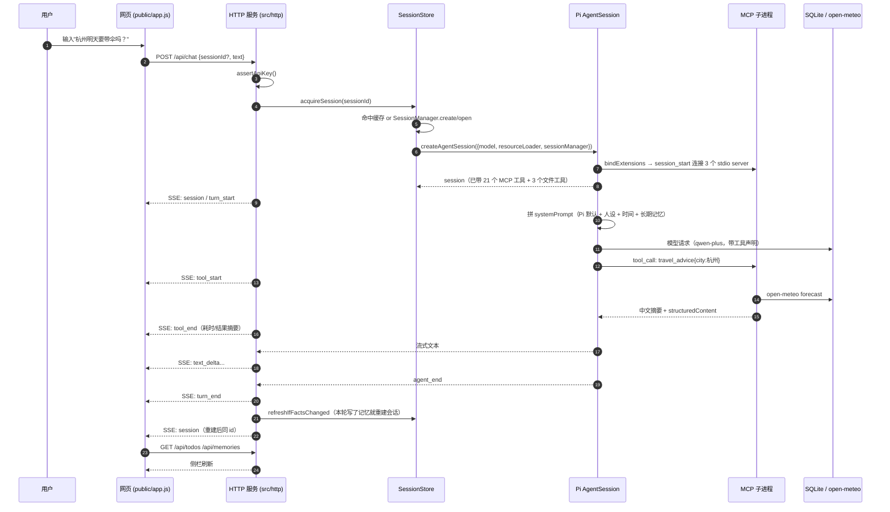

# 架构与数据流

## 1. 一次对话的完整时序



## 2. 三层结构

| 层 | 位置 | 职责 | 能独立测试吗 |
|---|---|---|---|
| MCP 工具层 | `mcp/` | 7 个服务器，每个都是独立进程，通过 stdio 说 MCP 协议。只依赖 `src/data` 与外部 API，不知道 Pi 的存在 | ✅ `npm run test:integration`（用 MCP SDK 的 Client 直连） |
| Agent 装配层 | `src/agent/` | 会话工厂、系统提示词、MCP 桥、文件工具、事件映射、会话缓存与热重建 | ✅ `npm run test:agent`（断言模型行为） |
| 接入层 | `src/http/` + `public/` | HTTP 路由、SSE、静态托管、零构建前端 | ✅ curl / 浏览器 |

分层的判据很简单：**MCP 层出问题，集成测试会红；agent 层出问题，行为测试会红；界面问题只会让浏览器这一端出错。** 排查时先看哪一层红，不用猜。

## 3. 记忆的两层与热注入

```
L1 会话内多轮   data/sessions/<id>.jsonl   ← SessionManager 落盘，重启服务/刷新页面可恢复
L2 长期事实     data/xiaopai.db: memories  ← MCP 工具写入，建会话时拼进 systemPrompt
```

难点：`session.systemPrompt` 是**只读**的。用户在对话中说出"我住在广州"，工具已经把事实写进表里，但当前会话的系统提示词改不了。

解法（`src/agent/sessionStore.ts`）：

1. 每个会话记录一个 `factsVersion`（`COUNT(*):MAX(updated_at)`）。
2. 每轮 `prompt` 结束、`agent_end` 之后比对版本号。
3. 版本变了 → 用**同一个 SessionManager** 重新 `createAgentSession`，`appendSystemPromptOverride` 会读到新记忆。
4. 旧 session `dispose()`，新 session 接管后续对话。

因为 SessionManager 里存的是完整历史条目，重建不会丢上下文；重建过程不发网络请求，实测 ~200ms，前端无感（`session` 事件再发一次同 id）。

## 4. 数据库并发

七个 MCP 服务器 + HTTP 主进程会同时访问 `data/xiaopai.db`：

- `PRAGMA journal_mode = WAL`：读写不互相阻塞。
- `PRAGMA busy_timeout = 5000`：撞锁时等 5 秒再说，而不是立刻 `SQLITE_BUSY`。
- 库路径由父进程通过 `XIAOPAI_DB` 环境变量透传给子进程，避免子进程 cwd 不同导致各建一个库。

## 5. 工具暴露方式

`exposure: "direct"` —— 21 个 MCP 工具像内置工具一样直接声明给模型。

没选 `codemode` / `deferred` 的原因：codemode 要模型先读工具文档、写 JS 脚本、再在 QuickJS 沙箱里执行，对 qwen-plus 级别模型来说多了一层失败模式，而且失败发生在沙箱里，界面上很难解释。工具只有 24 个，上下文成本可以接受。

## 6. 关键文件索引

| 文件 | 为什么值得看 |
|---|---|
| `src/agent/createSession.ts` | 模型 + 提示词 + 工具 + MCP 的装配点，30 行讲清整个 agent 怎么来的 |
| `src/agent/sessionStore.ts` | 记忆热注入的实现（唯一绕开只读 systemPrompt 的正解） |
| `src/agent/events.ts` | Pi 事件 → 前端事件的唯一映射层，Pi 升级只改这里 |
| `mcp/weather/advice.ts` | 纯函数规则引擎，不依赖模型、可单测 |
| `src/agent/mcpServers.ts` | 子进程启动描述（绝对 node 路径 + 绝对脚本路径，Windows 上必须这样） |
| `tests/integration/mcp.test.ts` | 把注册表与真实 `listTools` 对齐，加工具忘更新就会红 |
| `tests/agent/behavior.test.ts` | 行为测试：断言工具调用 + 数据库副作用 + 数值正确 |
