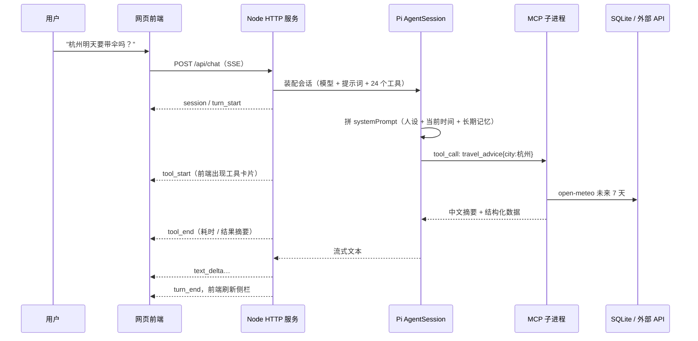
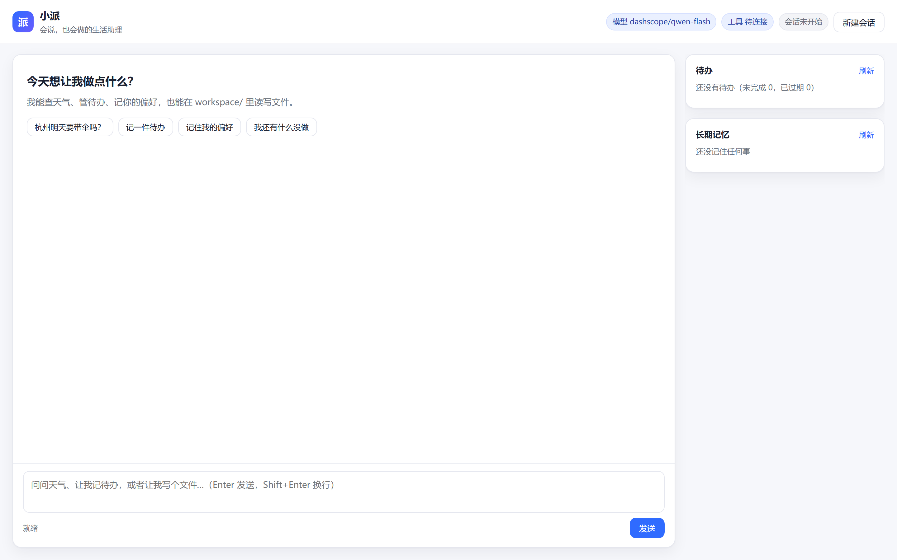
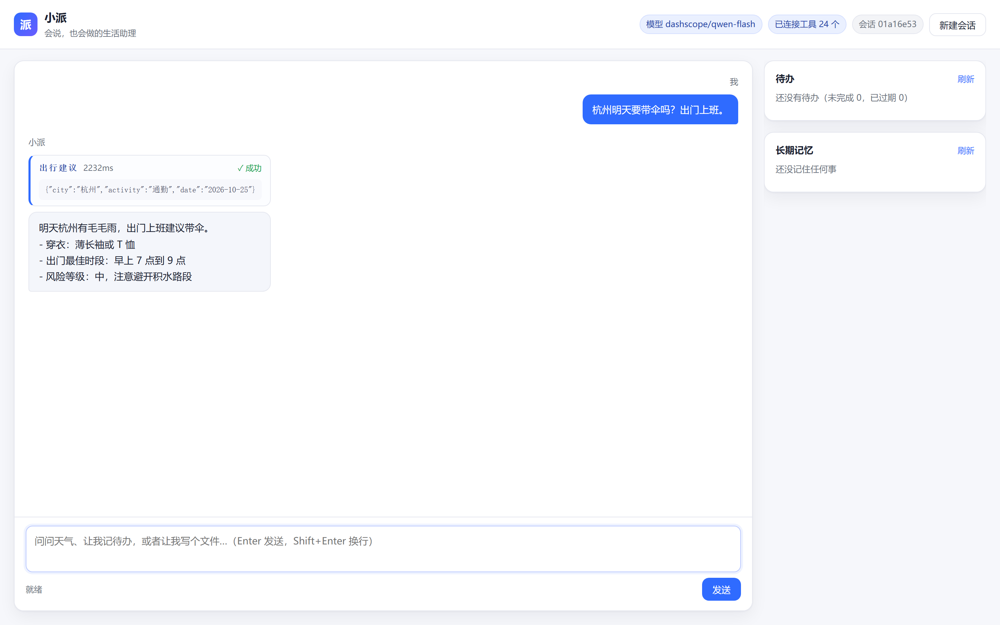
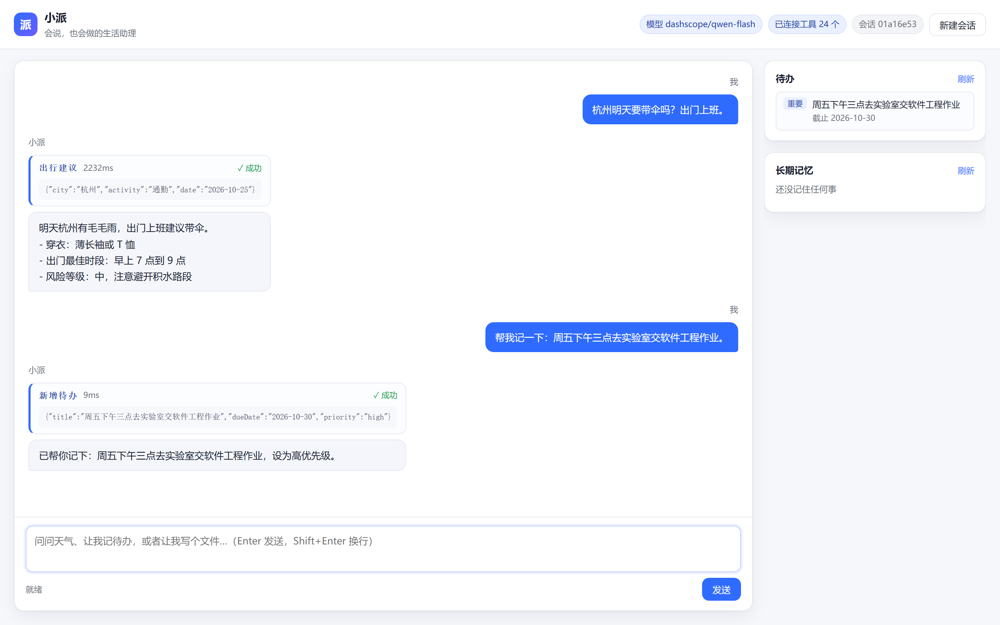
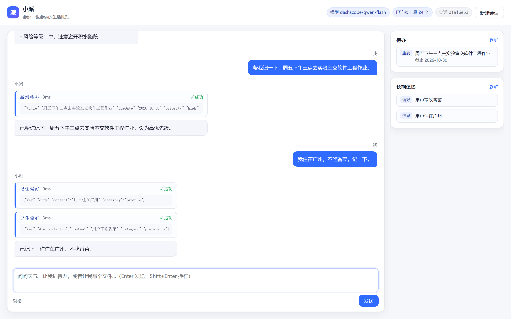
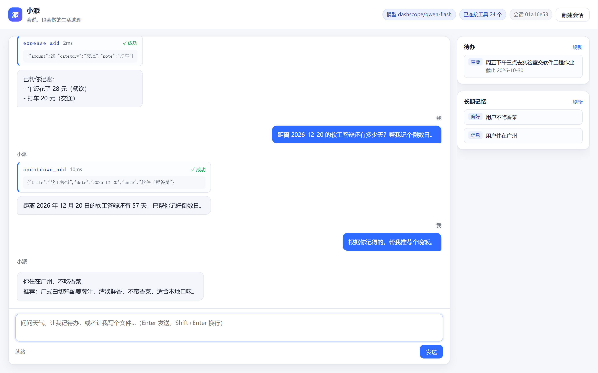
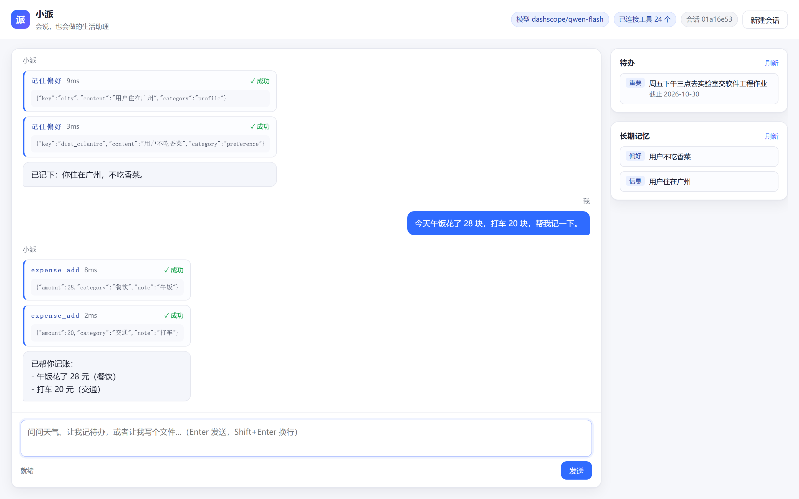
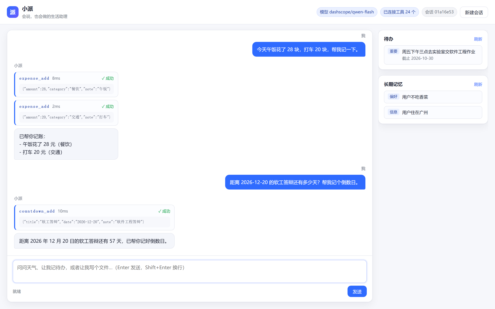
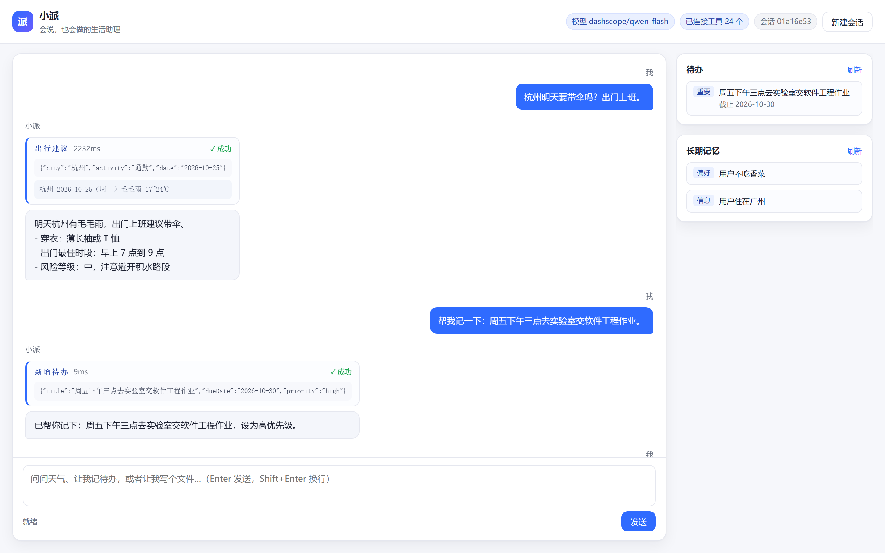

| 这个作业属于哪个课程 | 【待填：班级圈子链接】 |
|-------------------|-----------------|
| 这个作业要求在哪里 | 【待填：作业要求链接】 |
| 这个作业的目标     | 用现代 AI 工具构建一个"能说会做"的智能体：既能自然语言对话，又能调用工具真正执行操作；技术上使用 MCP 框架，并把智能体、工具、模型、界面完整串起来跑通 |
| 学号              | 【待填：王尉人】、【待填：组员B】、【待填：组员C】、【待填：组员D】 |

---

# 用 Pi + MCP 做一个"会说也会做"的生活助理：小派

## 一、需求描述

### 1.1 为什么要做这个

我们的生活信息散在四五个地方：天气在一个 App、待办在另一个、花了多少钱在账单里、考试还有几天靠脑子记。每次做"明天要不要带伞、这周钱花哪了"这种小决策，都要来回切三次应用。

所以我们的目标不是做一个"更聪明的聊天框"，而是做一个**能落地动作**的助理：聊天是入口，动作才是价值。

### 1.2 功能需求

| 编号 | 需求 | 验收标准 |
|---|---|---|
| F1 | 自然语言多轮对话 | 能理解上下文中的指代（"那后天呢"），不是一问一答的孤岛 |
| F2 | 天气与出行建议 | 输入城市名，返回实况/预报，并给出带伞、穿衣、最佳出门时段的建议 |
| F3 | 待办管理 | 用一句自然语言新增/查询/改状态/删除，数据重启后还在 |
| F4 | 长期记忆 | 用户说过的稳定事实（住哪、忌口）能被记住，并在**后续对话中自动生效** |
| F5 | 文件操作 | 能在受限目录内读写文件，越界必须被拒绝 |
| F6 | 结果可视化 | 每一次工具调用（调了什么、参数是什么、花了多久、返回了什么）在界面上可见 |
| F7 | 记账 | "今天午饭 28" 能落库，问"这周花了多少"能给出总额、笔数、日均、分类占比 |
| F8 | 倒数日 | "距离 12-20 答辩还有多少天"能算准剩余天数，并能列出全部节点 |
| F9 | 换算 | "5 英里多少公里""100 美元多少人民币"，单位与汇率都要准确 |
| F10 | 网页速读 | 给一个链接，能抓标题与正文并概括，抓不到要直说，不能凭标题编内容 |

### 1.3 非功能需求

- **可复现**：队友 clone 下来 `npm install && npm run dev` 就能跑，不需要装数据库、不需要编译原生模块。
- **低成本**：模型用免费额度，天气/汇率用免费公开 API，整个项目零外部付费依赖。
- **可分层验证**：MCP 层、Agent 层、界面层各有独立测试，出问题能立刻定位。
- **安全边界**：模型不能执行 shell，不能访问工作目录以外的文件，删除操作需要二次确认。

### 1.4 差异化：把"工具"做成真的能用的东西

同类作业大多停在"聊天 + 查天气/加待办"。我们在同样的框架里多做了一层：**让工具覆盖真实生活里高频、但别人不太会写的场景**，并且每个工具都有对应的测试。

一共 7 个 MCP 服务器、21 个 MCP 工具 + 3 个文件工具 = 24 个工具：

| 服务器 | 工具数 | 解决什么 |
|---|---|---|
| `xiaopai-weather` | 4 | 实况、多日预报、**出行建议规则引擎**（带伞/穿衣/最佳时段/风险等级） |
| `xiaopai-todo` | 4 | 待办增删改查，删除要二次确认 |
| `xiaopai-memory` | 3 | 长期事实，`key` 去重防记忆膨胀 |
| `xiaopai-expense` | 4 | 记账 + 按月/分类统计（总额、日均、占比） |
| `xiaopai-countdown` | 3 | 倒数日，算准剩余天数（跨月跨年不出错） |
| `xiaopai-convert` | 2 | 单位换算（纯本地）+ 实时汇率（免费接口） |
| `xiaopai-web` | 1 | 抓网页标题与正文，交给模型概括 |

这些工具不是把所有信息都丢进提示词让模型"记"，而是**该算的用代码算**：出行建议是纯函数、天数差是纯函数、单位换算是纯函数。所以同样的输入永远给同样的输出，演示不会因为模型随机性而变化。

## 二、业务流描述

### 2.1 整体链路



### 2.2 三条典型业务流

**流一：查天气 + 给建议（调外部 API + 纯函数规则）**

1. 用户："杭州明天要带伞吗？出门上班。"
2. 模型判断意图 → 调 `travel_advice{city:"杭州", activity:"通勤"}`（不需要先调地理编码，工具内部自己解析）。
3. MCP 进程请求 open-meteo：地理编码拿经纬度 → 预报接口拿 7 天逐日 + 逐小时。
4. 规则引擎算：降水概率 ≥50% 或天气码属于雨雪 → 要带伞；按 tempMax 给穿衣；在 07:00–21:00 里找连续两小时低降水窗口。
5. 返回中文摘要 → 模型组织成人话 → 前端边流边显示。

**流二：记待办 / 记账（写数据库）**

1. 用户："帮我记一下：周五下午三点去实验室交作业。"
2. 模型调 `todo_add` → MCP 进程写 SQLite（WAL 模式）。
3. 前端收到 `tool_end` 后刷新侧栏 → **右侧真的多出一条待办**。
4. 记账同理：一句"午饭 28、打车 20"会触发**两次** `expense_add`。

**流三：长期记忆（跨轮生效，本项目的技术难点）**

1. 用户："我住在广州，不吃香菜，记一下。"
2. 模型调 `memory_remember{key:"city"}` 和 `memory_remember{key:"diet_cilantro"}`，带 key 去重。
3. 后端在这一轮结束时发现记忆表的版本号变了 → **用同一个 SessionManager 重建 AgentSession**（历史不丢），新的 systemPrompt 里带上了这两条事实。
4. 下一轮问"帮我推荐个晚饭"，小派不用再问就知道"广州、不要香菜"。

## 三、实现说明

### 3.1 技术选型

| 层 | 选择 | 理由 |
|---|---|---|
| Agent 底座 | Pi（`@earendil-works/pi-coding-agent` 1.4.0，TypeScript SDK） | `createAgentSession()` 嵌进自己的进程，才能按请求装配会话、把事件转成网页流 |
| 行动能力 | 7 个自研 MCP 服务器（stdio）+ 3 个 Pi 扩展工具 | MCP 是作业推荐框架，子进程隔离也让我们能单独测试每个工具 |
| 模型 | 阿里云百炼 `qwen-flash`（OpenAI 兼容端点） | 免费额度内、中文好、多轮工具调用稳定；`config/models.json` 同时配了 qwen-plus/智谱/DeepSeek，改 `.env` 一行就能切 |
| 数据库 | Node 22 内置 `node:sqlite` | 免原生编译，队友 `npm install` 不会卡在 better-sqlite3 的 MSVC 编译上 |
| HTTP | 原生 `node:http` + SSE | 只要 6 个路由，原生 `res.write` 最不容易被缓冲 |
| 前端 | 零构建，原生 DOM | 截图脚本与演示链路最短，不需要等构建 |
| 测试 | `node:test` + MCP SDK Client | 零额外依赖，单元/集成/行为三层共 71 个用例 |

### 3.2 会话是怎么装配出来的

核心就 30 行（`src/agent/createSession.ts`）：

```ts
const resourceLoader = new DefaultResourceLoader({
  cwd: ROOT,
  agentDir: AGENT_DIR,
  extensionFactories: [
    createFileToolsExtension(),      // file_list / file_read / file_write
    createMcpBridgeExtension(),      // pi.registerMcpServer × 7
    createMcpExtension({ startupWaitMs: 15000 }),
  ],
  // 只追加不替换：Pi 默认提示词里有工具调用协议，小模型很依赖它
  appendSystemPromptOverride: (base) => [...base, "", buildPersonaAppend()],
});
await resourceLoader.reload();

const { session } = await createAgentSession({
  cwd: ROOT, agentDir: AGENT_DIR, model, modelRuntime: runtime,
  resourceLoader, settingsManager, sessionManager,
  thinkingLevel: "off",
  noTools: "builtin",   // 关掉内置 read/write/edit/bash
});
await session.bindExtensions({});   // 触发 session_start，MCP 在这里连上
```

三个决定值得展开：

**① 为什么用 `registerMcpServer` 而不是 `mcp.json` 文件？**
因为我们算出来的路径是绝对的（`process.execPath` + 绝对脚本路径）。`mcp.json` 走的是"配置目录 + 项目信任"的发现流程，Windows 上还容易因为 `npx` 和空格路径翻车。写在 TS 里，出问题一眼能看到传给子进程的是什么。

**② 为什么 `noTools: "builtin"` 而不是 `tools: [...]` 白名单？**
白名单会把 MCP 工具一起关掉（它们不在列表里）。`noTools: "builtin"` 只压内置工具，扩展和 MCP 工具照常生效。实测挂载结果：24 个工具 = 3 个文件工具 + 21 个 MCP 工具，`bash/read/write/edit` 全部不在活动列表里。

**③ 为什么工具用 `direct` 暴露，不用 codemode？**
Pi 1.0 的 codemode 让模型写一段 JS 去批量调工具，能把工具 schema 从上下文里省掉。但代价是模型要先读懂工具文档、写出正确脚本、还要在 QuickJS 沙箱里执行成功——这多出来的一层是实打实的失败率，而且失败发生在沙箱内部，界面上很难向用户解释。我们只有 24 个工具，直接声明放得下。

### 3.3 一个差点漏掉的坑：会话建好了，工具还没连上

`bindExtensions()` 只是"开始连接"，7 个 MCP 是独立子进程，工具是**异步**挂上来的。我们第一版没等，结果第一轮提问时模型只看到 3 个文件工具，它调了天气工具（那个先连上了），然后**用文字把"已帮你加待办"补上**——数据库里其实是空的。

这不是模型撒谎，是我们没把工具给全。修法是在会话工厂里加一道闸：

```ts
await session.bindExtensions({});
await waitForMcpTools(session);   // 轮询 getActiveToolNames()，21 个 MCP 工具到齐才放行
```

同一个问题也影响了界面：徽章上"已连接工具 3 个"其实是"刚连上 3 个"。现在改成在每轮 `turn_end` 再刷新一次，显示的是最终值 24。

**教训**：涉及外部进程的地方，"调用成功"不等于"已就绪"，必须有一个显式的就绪判断。

### 3.4 最难的一处：记忆怎么"当场生效"

Pi 的 `session.systemPrompt` 是**只读**的。这意味着：用户在对话中说出"我住在广州"，工具已经把事实写进了 `memories` 表，但当前会话的系统提示词改不了。

我们的做法（`src/agent/sessionStore.ts`）：

1. 每个会话记一个 `factsVersion = COUNT(*):MAX(updated_at)`。
2. 每轮 `prompt` 结束、`agent_end` 之后比对版本号。
3. 变了 → **用同一个 `SessionManager` 重新 `createAgentSession`**。历史条目原样复用，`appendSystemPromptOverride` 这次会读到新记忆。
4. 旧 session `dispose()`，新 session 接管后续对话。

关键点是"同一个 SessionManager"：它保存完整的历史条目树，所以重建**不等于**丢上下文；重建过程不发网络请求，实测约 200ms，前端无感知。

### 3.5 工具怎么设计得让模型不容易用错

- **工具描述写成"当用户……时调用"**，而不是"查询天气"。触发条件是模型最容易匹配的特征。
- **错误返回统一成 `错误[E_XXX] 人话原因`**：比如 `E_CITY_NOT_FOUND` 会带上建议"可以只写城市名，或告诉我省份"。
- **该让模型省事的地方就省事**：`weather_*` 三个工具内部自己解析城市名，提示词明确写"不要先调 `geocode_city`"。
- **记忆带 key 去重**：同一件事说三遍，表里也只有一行，否则提示词会越来越长。
- **删除必须二次确认**：`todo_delete` / `expense_delete` / `countdown_delete` 不带 `confirm=true` 时只返回"确认要删除 #3《…》吗"，既是安全边界，也顺带制造了多轮交互。
- **该用代码算的不用模型算**：单位换算、天数差、统计汇总、带伞判断全是纯函数，模型只负责"理解意图"和"组织语言"。

### 3.6 并发写同一个 SQLite

7 个 MCP 服务器是独立子进程，加上 HTTP 主进程，八个进程访问同一个库文件。做法：

- `PRAGMA journal_mode = WAL`：读写不互相阻塞；
- `PRAGMA busy_timeout = 5000`：撞锁时等一下，而不是立刻 `SQLITE_BUSY`；
- 库的绝对路径由父进程用 `XIAOPAI_DB` 环境变量透传给子进程，避免子进程 cwd 不同导致各建一个库（这个坑我们真踩过）。

## 四、测试

这一节想写清楚两件事：**代码怎么测**、**模型的行为怎么测**。

### 4.1 三层策略

| 层 | 被测对象 | 命令 | 用例 | 特点 |
|---|---|---|---|---|
| 单元测试 | 纯函数与仓储层 | `npm run test:unit` | 49 | 毫秒级、不联网；规则引擎、单位换算、日期计算、HTML 抽取、SQL 增删改查 |
| 集成测试 | MCP 协议 | `npm run test:integration` | 19 | 真的把 7 个服务器作为子进程启动，走 stdio 调工具 |
| 行为测试 | 模型决策 | `npm run test:agent` | 3 | 真实模型 + 真实数据库，断言"它调了哪个工具、数据有没有变" |

前两层不需要模型 key，`npm test` 一条命令跑完（68 个用例）；第三层没有 key 会自动跳过，不会让 CI 变红。

**为什么集成测试要"启动真进程"而不是 mock？** 因为我们踩过的坑几乎都在进程边界上：路径带空格、`npx` 在 Windows 上起不来、子进程 cwd 不同导致建了两个数据库。mock 掉这些，就等于把最容易翻车的部分排除了。

集成测试里有一条特意写成"与注册表对齐"：

```ts
const total = MCP_SERVERS.reduce((sum, s) => sum + s.toolCount, 0);
assert.equal(total, 21);

for (const def of MCP_SERVERS) {
  test(`${def.name}：listTools 数量和注册表一致`, async () => {
    const { tools } = await client.listTools();
    assert.equal(tools.length, def.toolCount);
  });
}
```

以后谁加了工具却忘了更新注册表，测试立刻红——这是我们能一直信任 `npm run tools` 输出"24 个工具"的原因。

### 4.2 单元测试抓到的两个真 bug

写测试不是为了让数字好看，它确实抓到了东西：

**bug 1：`normalizeUrl` 把 `ftp://` 拼成了 `https://ftp//`**

原实现只看开头是不是 `http(s)://`，不是就无脑补 `https://`。所以 `ftp://example.com` 变成 `https://ftp://example.com`，`URL` 解析后主机名成了 `ftp`，工具会去抓一个不存在的网站。修法是先判断"是否已带协议"，带了别的协议就直接拒绝。

**bug 2：最佳时段窗口少算一小时**

规则引擎给"10 点、11 点降水概率都低"时输出 `10:00-11:00`，但两小时窗口应该是 `10:00-12:00`。这条是测试预期写错了（改成 `10:00-12:00`），但它逼我们把"窗口"的定义写清楚：**从某个整点开始、持续两小时**。

### 4.3 行为测试：怎么测"模型的决策"

这是跟普通作业最不一样的地方。函数有确定的输入输出，模型没有，所以断言要落在**可观察的副作用**上：

```ts
async function runTurn(prompt: string) {
  const record = await acquireSession(null);
  const tools: string[] = [];
  const detach = record.session.subscribe((e) => {
    if (e.type === "tool_execution_start") tools.push(e.toolName);
  });
  await record.session.prompt(prompt);
  return { tools, reply: record.session.getLastAssistantText() ?? "" };
}

// 断言 1：它真的调了工具（而不是凭记忆编）
assert.ok(tools.includes("mcp__xiaopai_todo__todo_add"), `实际调用：${tools.join(",")}`);
// 断言 2：数据真的落库了（而不是嘴上说记下了）
const hit = listTodos({ status: "pending", limit: 50 }).find((t) => t.title.includes(title));
assert.ok(hit);
// 断言 3：算出来的数值对（而不是心算错）
assert.match(reply, /37\.7/);
```

**三个断言缺一不可**。只断言"调了工具"，模型可以调完不写库；只断言"回答里有数字"，模型可以瞎猜一个。

行为测试还专门处理了概率性：同一个 prompt 偶尔模型会选择"直接回答不调工具"，所以每个用例允许**重试 3 次**，三次都不过才报错，并把实际调用链打出来。

### 4.4 测试顺带发现的模型问题

这是这次做作业最有意思的收获：**同一套代码，换个模型，行为完全不一样**。

| 模型 | 多轮工具调用（连跑 3 轮 × 2 次） | 结论 |
|---|---|---|
| `qwen-flash` | 6/6 轮都正确调工具 | 采用为默认 |
| `qwen-plus` | 第 1 轮正常，**第 2 轮起必然不调工具**，直接用文字把结果"补"出来 | 备选，需注意 |

我们把每次请求的内容打印出来核对过（`XIAOPAI_DEBUG_REQUESTS=1`）：工具声明 24 个、`tool_choice` 是自动、消息结构 `system>user>assistant>tool>assistant>user` 完全正常。也就是说**不是我们的链路把工具弄丢了，是模型自己选择不调**。换回 `qwen-flash` 后问题消失。

这件事让我们把"默认模型"从"看起来更强的那个"改成了"在这个任务上更稳的那个"，也让行为测试里的重试变成了必需品而不是偷懒。

## 五、使用示例

以下全部是真实运行截图（`npm run shots` 驱动真实浏览器、真实模型产生），不是效果图。

### 示例一：问天气，拿到的是"行动建议"而不是一堆数字



输入"杭州明天要带伞吗？出门上班。"，小派调了 `travel_advice`，卡片上能看到工具名、参数、耗时和成功状态：



返回的是可以直接执行的四行：带伞（降水概率 14%）、穿薄长袖或 T 恤、最佳出门时段、风险等级。**规则是代码算的，不是模型编的**——`mcp/weather/advice.ts` 是纯函数。

### 示例二：说一句人话，待办真的落库



"周五下午三点去实验室交软件工程作业" → 调 `todo_add`，工具卡片显示写库成功，**右侧待办栏立刻多出一条，截止 2026-10-30**。这不是前端假装刷新，是把 `/api/todos` 重新查了一遍 SQLite。

### 示例三：说一次偏好，下一轮自动生效

第三轮说"我住在广州，不吃香菜，记一下"，模型分别调了两次 `memory_remember`（`key: city` 和 `key: diet_cilantro` 去重）：



第六轮只问"根据你记得的，帮我推荐个晚饭"，**没有重复任何前提**：



回答里出现了广州的菜和不放香菜的方案。这两条事实是前面才写进数据库的，本轮之所以能进系统提示词，靠的是服务端在轮次交界处重建了会话（见 3.4）。

### 示例四：一句"花了多少"，两次工具调用

"今天午饭花了 28 块，打车 20 块"——模型拆成两笔，**并行发了两次 `expense_add`**（8ms / 2ms），回答里分别给出分类：



问"这周花了多少"时会调 `expense_summary`，返回总额、笔数、有消费的天数、日均和分类占比。

### 示例五：算天数



"距离 2026-12-20 的软工答辩还有多少天" → `countdown_add`，返回剩余天数写进库；下次问"最近有什么节点"时用 `countdown_list` 按日期升序列出。天数用的是纯函数 `daysBetween()`，跨月跨年都有单测覆盖。

### 工具卡片的细节

点击卡片头部可以展开工具返回的原始内容，排查问题时很有用：



### 终端里的同一件事

不用界面也能验证（完整输出见 [`demo-transcript.md`](./demo-transcript.md)）：

```
[调用] mcp__xiaopai_weather__travel_advice {"city":"杭州","activity":"通勤","date":"2026-10-25"}
[调用] mcp__xiaopai_todo__todo_add {"title":"明天出门带伞", ...}
[结果] ✅ mcp__xiaopai_todo__todo_add (8ms) 已添加待办 #3：明天出门带伞
[结果] ✅ mcp__xiaopai_weather__travel_advice (2144ms) 杭州 2026-10-25（周日）毛毛雨 17~23℃
```

一句话里两件事，模型发了两个工具调用，而且几乎并行：写库 8ms，查天气 2144ms。这也顺便证明了 `tool_start` / `tool_end` 事件是真实逐条到达的。

### 一条真实的错误分支

地名有歧义时，工具返回的不是异常堆栈，而是一句人话：

```
错误[E_CITY_NOT_FOUND] 没找到"瞎编市"这个城市。可以换个说法（比如只写城市名、去掉区县），或者告诉我省份。
```

模型按提示词要求把原因翻译给用户，而不是假装查到了天气编一个温度出来。

## 六、GitHub 仓库

https://github.com/akcow/xiaopai-agent

```
xiaopai-agent/
├─ src/            常驻进程（配置 / 数据层 / agent 装配 / HTTP）
├─ mcp/            7 个独立 stdio MCP 服务器
├─ public/         零构建前端
├─ tests/          单元 49 / 集成 19 / 行为 3 个用例
├─ scripts/        冒烟、工具检查、截图、提交时间线
├─ config/         models.json、persona.md
└─ docs/           架构、工具手册、演示实录、截图
```

## 七、小组分工

| 成员 | 负责模块 | 具体做了什么 |
|---|---|---|
| 王尉人（组长） | 工程骨架 + Agent 核心 + 集成 | TypeScript/Node 工程；接 Pi SDK；会话装配、提示词拼装、MCP 桥、会话持久化与记忆热注入；集成、构建、发布 |
| 组员B | 天气 MCP 全栈 | 城市地理编码（别名、去后缀）、open-meteo 实况与预报、出行建议规则引擎 |
| 组员C | 数据层 + 待办/记忆/记账 MCP | SQLite 表结构、待办增删改查与二次确认、记忆去重、记账统计；修并发写库问题 |
| 组员D | 前端 + 可视化 + 测试与文档 | 零构建界面、SSE 流式解析、工具卡片与侧栏；三层测试（单测/集成/行为）；截图与本文 |

提交数：王尉人 7 条、组员B 2 条、组员C 3 条、组员D 3 条，共 15 条，集中在两天内（`git shortlog -sn` 可核对）。

## 八、每个人的心得

### 王尉人（组长）

最花时间的不是写代码，是**搞清 Pi 的 SDK 边界**：文档写"MCP 扩展是内置的"，那是对 CLI 说的——用 SDK 时得自己 `createMcpExtension()` 塞进 `extensionFactories`，还要在 `session_start` 后调 `bindExtensions()`，否则一个 MCP 工具都挂不上。另外 `session.systemPrompt` 是只读的，第一次看到这个限制我以为记忆没法热更新，后来想通"用同一个 SessionManager 重建会话"，历史不丢、提示词重算，反而比改提示词更干净。最值的一个教训：会话建好 ≠ 工具就绪，第一轮提问时模型会因为看不到工具而"编"一句"已帮你加好"。

### 组员B

天气最反直觉的是**地理编码**：open-meteo 对"杭州市"的匹配反而不如"杭州"，所以要先去后缀，再补别名表（沪→上海、帝都→北京）。WMO 返回的天气是数字码（0/45/61…），模型完全看不懂，必须自己翻译。出行建议我们坚持写成纯函数——测试里给它喂"10 点、11 点降水概率都低"的构造数据，才发现窗口标签少算了一小时，这种错靠肉眼看代码基本发现不了。

### 组员C

数据层踩了两个坑。一是**八个进程抢一个库**：HTTP 主进程加 7 个 MCP 子进程，早期频繁 `SQLITE_BUSY`，加了 WAL 和 `busy_timeout=5000` 才稳。二是**子进程 cwd 不一样**，早期各建了一个 db 文件，界面上和子进程里查到的对不上——后来库路径统一由父进程用 `XIAOPAI_DB` 透传绝对路径才解决。记账那部分最有意思：金额要用 REAL 存但显示必须固定两位小数，日均还要处理"没有任何消费"时的除零。

### 组员D

前端看起来简单，坑不少。SSE 不能按行读，要按 `\n\n` 切事件；工具名不是 `weather_forecast` 而是 `mcp__xiaopai_weather__weather_forecast`，服务器名里的 `-` 会变成 `_`。测试这块收获最大：写集成测试时把 7 个服务器真当子进程拉起来，工具数量直接跟注册表对齐，谁忘了更新马上红；写行为测试时第一次见到"同一句话，模型这次调工具、下次不调"，才明白 LLM 的测试必须允许重试，而且断言要看数据库副作用而不是回答好不好听。

## 九、学习资源推荐

**官方文档（必读）**

- Pi 官方文档：https://pi.dev/docs —— 尤其 SDK、MCP、Sessions、Models 四页，比任何二手教程都准
- Pi 仓库里的 SDK 示例：`packages/coding-agent/examples/sdk/`（01-minimal、05-tools、06-extensions、14-codemode-mcp 最有价值）
- MCP 官方规范：https://modelcontextprotocol.io —— 重点看 tools 的 `inputSchema` 与 `isError` 约定
- MCP TypeScript SDK：https://github.com/modelcontextprotocol/typescript-sdk

**数据与基础能力**

- open-meteo 文档：https://open-meteo.com/en/docs —— 免费、无 key，天气码是数字要自己翻译
- open.er-api.com 免费汇率接口：https://www.exchangerate-api.com/docs/free
- Node 内置 SQLite：https://nodejs.org/api/sqlite.html
- Node 内置测试运行器：https://nodejs.org/api/test.html —— 我们三层测试全靠它，零依赖
- SSE 规范：https://html.spec.whatwg.org/multipage/server-sent-events.html

**课程提供的资源（我们也看过）**

- MCP 快速入门指南（官方教程）
- 动手学多智能体系统实战教程 Hello-Agents
- MCP 协议深度解析与实战应用

**一点经验**：MCP 的坑大多不在协议本身，而在**进程启动**（Windows 上用 `npx` 起服务、路径带空格、子进程 cwd 不同导致建了两份库）。所以我们写的第一个脚本不是"跑通对话"，而是"不经过模型，先确认每个服务器能被连上、工具能被调用"。这个顺序省了我们很多时间。
